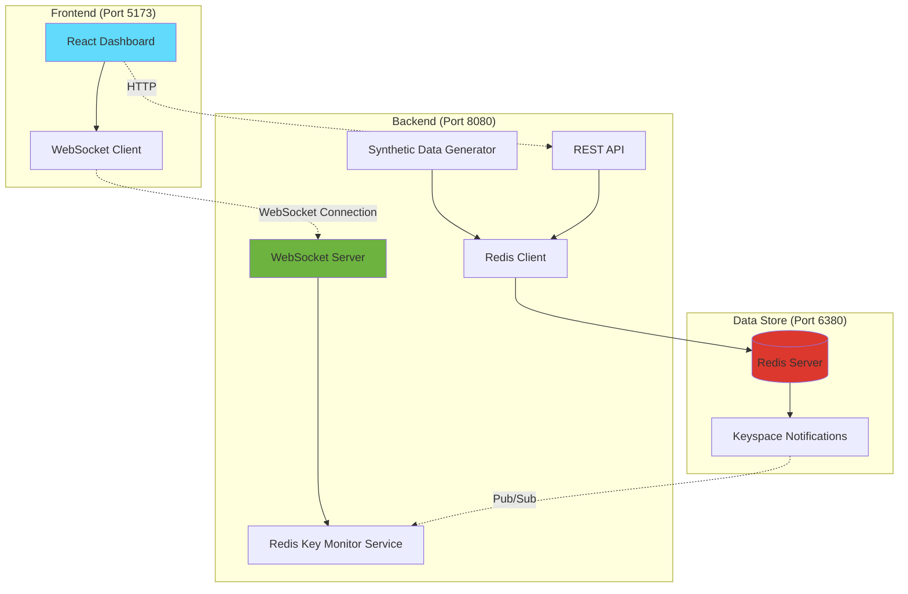
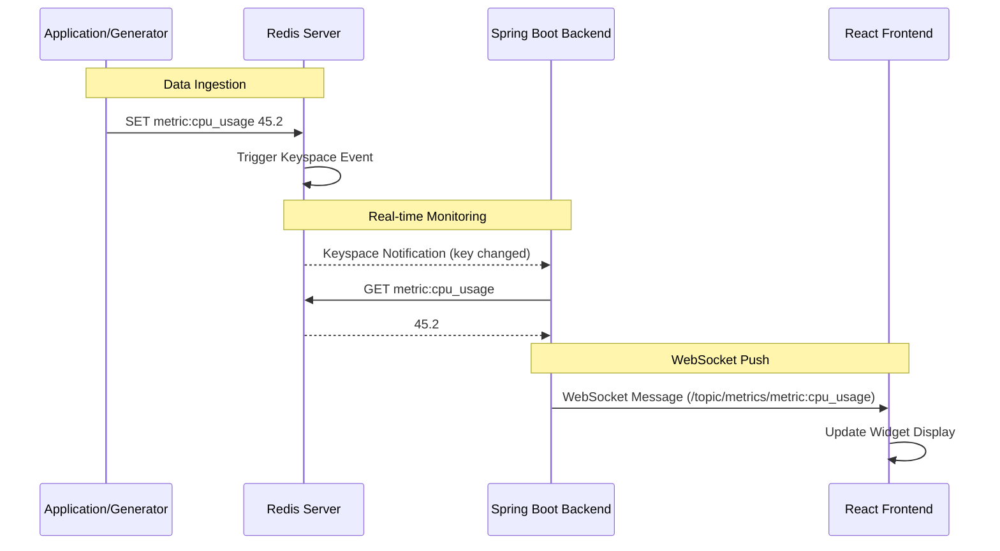
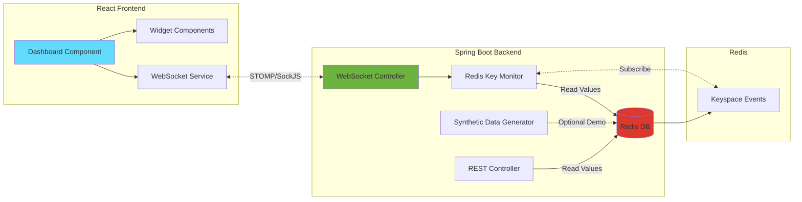

# Redis Monitor Dashboard

A real-time monitoring dashboard for Redis keys with a Spring Boot backend and React frontend. Monitor counters, gauges, and time-series metrics with live updates via WebSocket.

**Version:** 2.0  
**Last Updated:** November 8, 2025

---

## 📚 Documentation

- **[Quick Start Guide](QUICK_START.md)** - Get up and running in minutes
- **[Complete Documentation](DOCUMENTATION.md)** - Architecture, setup, API reference, troubleshooting
- **[Multi-Dashboard Guide](MULTI_DASHBOARD.md)** - Working with multiple dashboards
- **[Dynamic Metric Selector](METRIC_SELECTOR.md)** - Change metrics in real-time via dropdown

---

## 🚀 Quick Start

### Using Scripts (Recommended)

```bash
# Start all services (Redis, Backend, Frontend)
./start-all.sh

# Stop all services
./stop-all.sh
```

Then open **http://localhost:5173**

### Manual Startup

```bash
# Terminal 1: Start Redis
docker-compose up -d

# Terminal 2: Start Backend
cd backend && mvn spring-boot:run

# Terminal 3: Start Frontend
cd frontend && npm run dev
```

### Access Points

| Service | URL | Description |
|---------|-----|-------------|
| **Frontend** | http://localhost:5173 | Main dashboard |
| **Backend API** | http://localhost:8080 | REST & WebSocket endpoint |
| **Redis** | localhost:6380 | Redis connection |

---

## ✨ Key Features

### Core Features
- 🔄 **Real-time Updates** - WebSocket-based live data streaming
- 📊 **Multiple Widget Types** - Counters, Gauges, and Line Charts
- 🎨 **Configurable Dashboards** - JSON-based configuration
- 📱 **Responsive Layout** - Adaptive grid system
- 🔌 **Redis Keyspace Notifications** - Event-driven updates

### Dashboard Management
- 🎯 **Multiple Dashboards** - Switch between different dashboard configurations
- 📋 **Dashboard Selector** - Dropdown to switch views on the fly
- 🔄 **URL-based Selection** - Direct links to specific dashboards

### Available Dashboards
- **System Metrics** (default) - Full monitoring view with CPU, memory, requests, errors, connections
- **Minimal** - Simplified view (CPU, requests, errors)
- **Network** - Network-focused metrics (connections, throughput, latency)

Access via:
- http://localhost:5173?dashboard=system-metrics
- http://localhost:5173?dashboard=minimal
- http://localhost:5173?dashboard=network

---

## 🏗️ Architecture

### Technology Stack

- **Frontend**: React 18 + TypeScript + Vite (Port 5173)
- **Backend**: Spring Boot 3.2 + Java 21 (Port 8080)
- **Database**: Redis 7 with Keyspace Notifications (Port 6380)
- **Communication**: WebSocket (STOMP over SockJS)

### High-Level Architecture



### Data Flow Sequence



### Component Interaction



### Data Flow Steps

1. **Application** writes metric to Redis (`SET metric:cpu_usage 45.2`)
2. **Redis** triggers keyspace notification
3. **Backend** receives notification via pub/sub
4. **Backend** fetches current value from Redis
5. **Backend** pushes update via WebSocket
6. **Frontend** receives update and renders widget

### Why This Design?

#### Redis Keyspace Notifications

Traditional polling approaches query Redis periodically, causing:
- **Increased latency** - Poll interval delay
- **Unnecessary load** - Constant querying even when no changes
- **Inefficient resource usage** - Wasted CPU and network

Keyspace notifications provide **event-driven updates**:
- ✅ **Near-instantaneous updates** - Millisecond latency
- ✅ **Zero polling overhead** - Only notified on changes
- ✅ **Efficient** - Minimal resource usage

#### WebSocket vs HTTP Polling

| Aspect | HTTP Polling | WebSocket |
|--------|-------------|----------|
| **Latency** | High (poll interval) | Near real-time |
| **Overhead** | High (repeated handshakes) | Low (persistent connection) |
| **Scalability** | Poor (many requests) | Good (one connection) |
| **Bandwidth** | High (headers + data) | Low (data only) |
| **Server Load** | High (constant requests) | Low (push on change) |

#### Why STOMP over SockJS?

- **Protocol abstraction** - Simple pub/sub messaging
- **Fallback support** - Works even if WebSocket blocked
- **Spring Boot integration** - Native support
- **Topic-based routing** - Subscribe to specific metrics

---

## 📦 Project Structure

```
redis_monitor/
├── backend/                 # Spring Boot application
│   ├── src/main/java/com/redismonitor/
│   │   ├── config/         # WebSocket & Redis configuration
│   │   ├── controller/     # REST & WebSocket controllers
│   │   ├── model/          # Data models
│   │   └── service/        # Business logic & data generation
│   └── pom.xml
├── frontend/               # React application
│   ├── src/
│   │   ├── components/     # Dashboard & widget components
│   │   ├── config/         # Dashboard configurations
│   │   ├── services/       # WebSocket service
│   │   └── types/          # TypeScript types
│   └── package.json
├── docker-compose.yml      # Redis container
├── start-all.sh           # Start all services
├── stop-all.sh            # Stop all services
├── start-redis.sh         # Start Redis only
├── start-backend.sh       # Start backend only
└── start-frontend.sh      # Start frontend only
```

---

## 🛠️ Prerequisites

- **Java 21** (OpenJDK or Amazon Corretto)
- **Maven 3.6+**
- **Node.js 18+**
- **Docker & Docker Compose**

---

## ⚙️ Configuration

### Dashboard Configuration

Create or edit JSON files in `frontend/src/config/`:

```json
{
  "name": "System Metrics Dashboard",
  "refreshInterval": 2000,
  "widgets": [
    {
      "id": "cpu-usage",
      "title": "CPU Usage",
      "redisKey": "metric:cpu_usage",
      "type": "gauge",
      "format": "percentage",
      "unit": "%",
      "min": 0,
      "max": 100,
      "width": 3,
      "height": 1
    }
  ]
}
```

### Widget Types

#### Counter
Display a single numeric value
- **Formats**: `number`, `percentage`, `milliseconds`
- **Best for**: Total requests, error counts, latency

#### Gauge
Visual arc display with min/max range
- **Color-coded**: green (0-50%), orange (50-75%), red (75-100%)
- **Best for**: CPU usage, memory usage, capacity

#### Line Chart
Time-series visualization (last 50 data points)
- **Best for**: Requests per second, throughput over time
- **Redis Format**: `{"timestamp": 1699999999999, "value": 123}`

### Widget Properties

| Property | Type | Description |
|----------|------|-------------|
| `id` | string | Unique widget identifier |
| `title` | string | Display title |
| `redisKey` | string | Redis key to monitor |
| `type` | string | Widget type: `counter`, `gauge`, `line-chart` |
| `format` | string | Value format: `number`, `percentage`, `milliseconds` |
| `unit` | string | Display unit (e.g., "%", "MB", "ms") |
| `min` | number | Minimum value for gauge |
| `max` | number | Maximum value for gauge |
| `width` | number | Grid columns (1-12) |
| `height` | number | Grid rows |

---

## 📊 Synthetic Data

### Purpose

The synthetic data generator is a **demonstration feature** that:
- Shows how to write metrics to Redis
- Demonstrates real-time updates
- Provides sample data for testing

⚠️ **Important**: In production, you will **NOT** generate data within the monitoring app. Your actual applications write metrics to Redis, and this app only **observes** them.

### Generated Metrics

| Redis Key | Type | Description | Pattern |
|-----------|------|-------------|---------|
| `metric:cpu_usage` | Gauge | CPU percentage | Oscillates 10-90% |
| `metric:memory_mb` | Gauge | Memory in MB | Slowly increases 1024-4096 |
| `metric:total_requests` | Counter | Request count | Always increasing |
| `metric:error_count` | Counter | Error count | Occasionally increases |
| `metric:avg_response_time_ms` | Gauge | Response time | Random 50-500ms |
| `metric:active_connections` | Gauge | Active connections | Random 30-100 |
| `metric:timeseries:requests_per_sec` | Time Series | RPS with timestamp | Random 50-150 |

### Disabling Synthetic Data

Edit `backend/src/main/resources/application.yml`:

```yaml
redis-monitor:
  synthetic-data:
    enabled: false  # Set to false
    interval-ms: 2000
```

---

## 🔧 Custom Metrics

### Publishing to Redis

#### Command Line
```bash
# Simple value
docker exec -it redis-monitor redis-cli SET metric:my_counter 42

# Time series (JSON format)
docker exec -it redis-monitor redis-cli SET metric:timeseries:my_metric \
  '{"timestamp":1699999999999,"value":123}'
```

#### Python
```python
import redis
import json
import time

r = redis.Redis(host='localhost', port=6380)

# Counter metric
r.set('metric:api_requests', 12345)

# Gauge metric
r.set('metric:cpu_usage', '67.8')

# Time series with timestamp
data = {
    'timestamp': int(time.time() * 1000),
    'value': 234
}
r.set('metric:timeseries:throughput', json.dumps(data))
```

#### Java
```java
@Autowired
private RedisTemplate<String, Object> redisTemplate;

// Counter
redisTemplate.opsForValue().set("metric:order_count", "1500");

// Time series
String data = String.format("{\"timestamp\":%d,\"value\":%d}", 
    System.currentTimeMillis(), 567);
redisTemplate.opsForValue().set("metric:timeseries:orders_per_min", data);
```

#### Node.js
```javascript
const redis = require('redis');
const client = redis.createClient({ port: 6380 });

await client.connect();

// Counter
await client.set('metric:websocket_connections', '42');

// Time series
const data = {
    timestamp: Date.now(),
    value: 89
};
await client.set('metric:timeseries:events', JSON.stringify(data));
```

### Metric Naming Convention

**Recommended Pattern**: `metric:<category>:<name>`

Examples:
- `metric:api_requests`
- `metric:database_connections`
- `metric:timeseries:requests_per_sec`

---

## 🔌 API Reference

### REST API

#### Get Available Metrics (NEW!)
```
GET http://localhost:8080/api/metrics/available
```

Returns: `["cpu_usage", "memory_mb", "total_requests", ...]`

#### Get Current Value
```
GET http://localhost:8080/api/metrics/current/{key}
```

Example:
```bash
curl http://localhost:8080/api/metrics/current/cpu_usage
```

#### Get History
```
GET http://localhost:8080/api/metrics/history/{key}
```

### WebSocket API

**Endpoint**: `ws://localhost:8080/ws-redis-monitor`

#### Subscribe to Keys
```javascript
stompClient.send('/app/subscribe', {}, JSON.stringify({
  keys: ['metric:cpu_usage', 'metric:memory_mb']
}));
```

#### Unsubscribe from Keys
```javascript
stompClient.send('/app/unsubscribe', {}, JSON.stringify({
  keys: ['metric:cpu_usage']
}));
```

#### Receive Updates
Subscribe to topic: `/topic/metrics/{redisKey}`

```javascript
stompClient.subscribe('/topic/metrics/metric:cpu_usage', (message) => {
  const update = JSON.parse(message.body);
  // { key, value, timestamp, operation }
});
```

---

## 🐛 Troubleshooting

### Backend Won't Start
- **Check Java version**: `java -version` (should be 21+)
- **Ensure Redis is running**: `docker ps | grep redis-monitor`
- **Check port 8080**: `lsof -i :8080`
- **View logs**: `tail -f backend.log`

### Frontend Won't Connect
- **Verify backend is running**: `curl http://localhost:8080/api/metrics/available`
- **Check port 5173**: Frontend runs on 5173, NOT 3000 (LangFuse uses 3000)
- **Browser console**: Check for WebSocket errors
- **Hard refresh**: Cmd+Shift+R (Mac) or Ctrl+Shift+R (Windows)

### No Data Showing
- **Check synthetic data enabled**: `backend/src/main/resources/application.yml`
- **Check Redis keys**: `docker exec -it redis-monitor redis-cli KEYS "metric:*"`
- **Manually set metric**: `docker exec -it redis-monitor redis-cli SET metric:test 42`
- **Browser console**: Check for subscription errors

### Redis Connection Refused
- **Ensure Docker is running**: Check Docker Desktop/Rancher Desktop
- **Start Redis**: `docker-compose up -d`
- **Test connection**: `nc -zv localhost 6380`
- **Check logs**: `docker logs redis-monitor`

### Port Conflicts
- **Port 8080 in use**: `kill $(lsof -t -i:8080)` (often Jenkins)
- **Port 5173 in use**: `kill $(lsof -t -i:5173)`
- **Port 6380 in use**: Check Redis is mapped correctly

---

## 📜 Startup Scripts

All scripts are executable and located in the project root.

### start-all.sh
Automated startup for all services:
- Starts Redis via Docker Compose
- Starts Spring Boot backend (with health check)
- Starts Vite frontend (with health check)
- Opens browser automatically (macOS)

```bash
./start-all.sh
```

### stop-all.sh
Stops all running services:
- Stops frontend (port 5173)
- Stops backend (port 8080)
- Stops Redis (docker-compose down)

```bash
./stop-all.sh
```

### Individual Service Scripts

```bash
./start-redis.sh      # Start Redis only
./start-backend.sh    # Start backend only
./start-frontend.sh   # Start frontend only
```

---

## 🔍 Component Details

### Frontend (React + TypeScript)

**Port**: 5173  
**Framework**: Vite + React 18  
**Build Tool**: npm/Vite

#### Key Components

| Component | Purpose | Key Features |
|-----------|---------|-------------|
| `App.tsx` | Main application entry | Dashboard routing, WebSocket lifecycle management, connection state |
| `Dashboard.tsx` | Grid layout manager | Renders widgets in responsive grid, manages widget state |
| `DashboardSelector.tsx` | Dashboard switcher | Dropdown for switching dashboards, URL synchronization |
| `CounterWidget.tsx` | Numeric display | Single value with formatting (number, percentage, milliseconds) |
| `GaugeWidget.tsx` | Arc gauge | Visual arc with color coding (green/orange/red), min/max range |
| `LineChartWidget.tsx` | Time-series chart | Last 50 data points, auto-updating, uses Recharts |
| `WebSocketService.ts` | STOMP client wrapper | Handles WebSocket connection, subscription management, reconnection |

#### Configuration Files

- `src/config/dashboards.ts` - Dashboard registry and routing
- `src/config/example-dashboard.json` - Default system metrics dashboard
- `src/config/minimal-dashboard.json` - Simplified 3-widget view
- `src/config/network-dashboard.json` - Network-focused metrics

#### Component Responsibilities

**Frontend handles:**
- Dashboard rendering and layout
- WebSocket connection management
- Widget-specific visualization logic
- Dashboard configuration loading
- Real-time data updates
- User interface interactions

### Backend (Spring Boot)

**Port**: 8080  
**Java Version**: 21  
**Build Tool**: Maven  
**Framework**: Spring Boot 3.2

#### Key Services

| Service | Purpose | Key Features |
|---------|---------|-------------|
| `RedisKeyMonitorService` | Keyspace event listener | Subscribes to Redis keyspace events, fetches values, broadcasts via WebSocket |
| `SyntheticDataGenerator` | Demo data generator | Generates realistic metric patterns (oscillating, increasing, random) |
| `MetricSubscriptionController` | WebSocket message handler | Manages client subscriptions/unsubscriptions |
| `MetricController` | REST API | Current values, history, available metrics discovery |

#### Configuration Classes

- `WebSocketConfig.java` - STOMP endpoint (`/ws-redis-monitor`), message broker setup
- `RedisConfig.java` - Redis connection, listener container, keyspace notification config
- `application.yml` - Redis host/port, synthetic data settings, server port

#### Component Responsibilities

**Backend handles:**
- Redis keyspace event subscription
- WebSocket message brokering
- Initial value fetching
- Historical data aggregation
- Metric discovery (scanning Redis keys)
- Optional synthetic data generation

### Redis

**Port**: 6380 (external), 6379 (internal)  
**Version**: Redis 7 Alpine  
**Container**: `redis-monitor`  
**Special Config**: Keyspace notifications enabled (`KEA`)

#### Keyspace Notifications Configuration

Redis is started with: `--notify-keyspace-events KEA`

| Flag | Meaning | Purpose |
|------|---------|----------|
| **K** | Keyspace events | Publishes events on `__keyspace@0__:*` channels |
| **E** | Keyevent events | Publishes events on `__keyevent@0__:*` channels |
| **A** | All events | Includes set, del, expire, and all other commands |

#### Event Format

When `SET metric:cpu_usage 45.2` is executed:
- **Channel**: `__keyspace@0__:metric:cpu_usage`
- **Message**: `set` (the operation)
- **Backend** receives notification and fetches the value

#### Component Responsibilities

**Redis handles:**
- Metric storage (key-value pairs)
- Keyspace event emission
- Historical data (lists for time series)
- Pub/Sub for keyspace notifications

---

## 🚢 Deployment

### Backend Build

```bash
cd backend
mvn clean package
java -jar target/redis-monitor-backend-1.0.0.jar
```

### Frontend Build

```bash
cd frontend
npm run build
```

Production files will be in `frontend/dist/`

### Deployment Considerations

1. **Redis Connection**: Update `application.yml` with your Redis host/port
2. **Security**: Add authentication to WebSocket and Redis connections
3. **Scaling**: Use Redis Pub/Sub for multi-instance deployments
4. **Monitoring**: Monitor the monitor itself (meta-monitoring)
5. **Data Retention**: Set TTLs on time-series keys to prevent unbounded growth

---

## 🎨 Advanced Configuration

### Creating New Dashboards

1. **Create JSON file** in `frontend/src/config/my-dashboard.json`:

```json
{
  "name": "My Custom Dashboard",
  "refreshInterval": 2000,
  "widgets": [
    {
      "id": "my-metric",
      "title": "My Metric",
      "redisKey": "metric:my_value",
      "type": "counter",
      "format": "number",
      "unit": "",
      "width": 3,
      "height": 1
    }
  ]
}
```

2. **Register in** `frontend/src/config/dashboards.ts`:

```typescript
import myDashboard from './my-dashboard.json';

export const dashboards: DashboardRegistry = {
  'system-metrics': exampleDashboard as DashboardConfig,
  'my-dashboard': myDashboard as DashboardConfig,
};
```

3. **Access** at: http://localhost:5173?dashboard=my-dashboard

### Custom Widgets

1. Create widget component in `frontend/src/components/widgets/`
2. Add type to `frontend/src/types/dashboard.ts`
3. Register in `Dashboard.tsx` render switch

### Backend Customization

- **WebSocket endpoint**: Edit `WebSocketConfig.java`
- **Synthetic data interval**: Edit `application.yml`
- **Custom Redis listeners**: Edit `RedisKeyMonitorService.java`

---

## 📝 Recent Changes (v2.0)

### Port Corrections
- ✅ Frontend: 3000 → **5173** (Vite default)
- ✅ Clarified: Port 3000 is used by LangFuse, NOT the UI
- ✅ Redis: Confirmed port 6380 (external)

### Startup Automation
- ✅ Created `start-all.sh` - One-command startup with health checks
- ✅ Created `stop-all.sh` - Clean shutdown of all services
- ✅ Created individual service scripts (redis, backend, frontend)
- ✅ Added automatic browser opening (macOS)
- ✅ Added color-coded output and status summaries

### Documentation Overhaul
- ✅ Comprehensive architecture documentation with Mermaid diagrams
- ✅ Complete API reference
- ✅ Detailed troubleshooting guide
- ✅ Production usage patterns
- ✅ Quick start guide

### Backend Enhancement
- ✅ Added `/api/metrics/available` endpoint
- ✅ Auto-discovers all metrics in Redis
- ✅ Returns sorted list of metric names
- ✅ No configuration required

### UI Improvements
- ✅ Enhanced dashboard selector visibility (cyan theme)
- ✅ Improved component styling
- ✅ Better color contrast for Chrome/Safari
- ✅ Simplified UI by removing redundant selectors

---

## 🎯 Use Cases

### Development & Testing
- **Synthetic Data**: Built-in data generator for testing
- **Multiple Dashboards**: Switch views for different scenarios
- **Real-time Updates**: See changes immediately

### Production Monitoring
- **Application Metrics**: Monitor your app's performance
- **Infrastructure Metrics**: Track system resources
- **Business Metrics**: Watch key performance indicators
- **Custom Dashboards**: Create views for different teams

### Debugging
- **Live Metrics**: See real-time metric values
- **Historical Data**: Review time-series charts
- **Multi-Environment**: Same dashboard across dev/staging/prod

---

## 🔮 Future Enhancements

### Potential Improvements
- [ ] **Authentication**: Add user authentication
- [ ] **Metric Metadata**: Store and display descriptions/units
- [ ] **Alerts**: Set thresholds and receive notifications
- [ ] **Export**: Export dashboard configurations
- [ ] **Custom Widgets**: Plugin system for custom widget types
- [ ] **Time Range**: Select historical time ranges
- [ ] **Themes**: Dark/light theme toggle
- [ ] **Mobile**: Responsive mobile layouts
- [ ] **Favorites**: Star frequently used metrics
- [ ] **Search/Filter**: Filter long metric lists

---

## 📄 License

MIT

---

## 🤝 Contributing

Pull requests welcome! Please ensure:
- Backend code follows Spring Boot conventions
- Frontend uses TypeScript with strict mode
- Components are responsive
- Documentation is updated
- Tests are included for new features

---

## 📚 Additional Resources

- **Spring Boot WebSocket**: https://spring.io/guides/gs/messaging-stomp-websocket/
- **Redis Keyspace Notifications**: https://redis.io/docs/manual/keyspace-notifications/
- **Recharts Documentation**: https://recharts.org/
- **STOMP Protocol**: https://stomp.github.io/
- **Vite**: https://vitejs.dev/

---

**Questions or issues?** Check [DOCUMENTATION.md](DOCUMENTATION.md) for detailed information or [QUICK_START.md](QUICK_START.md) for quick reference.
